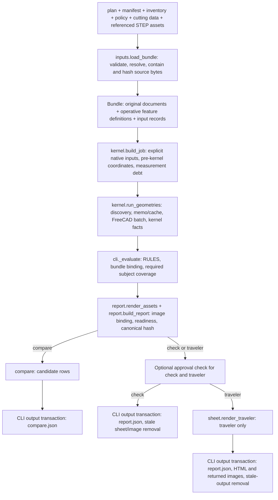

# Architecture

Prechips checks an authored machining plan against a feature manifest, shop inputs and declared geometry models. Its outputs are a deterministic report and machinist-facing setup sheets. It does not generate or simulate a complete toolpath, certify workholding or prove that a physical part can be machined safely.

[Documentation](../README.md) | [Development](development.md) | [Python interfaces](../reference/python-api.md) | [Internal split design](../module-split.md)

## Application data flow

[`cli.py`](../../src/prechips/cli.py) owns this orchestration. It loads every candidate and checks output targets before starting native evaluation. One prepared job per bundle feeds both the native request and geometry-rule consumers. The CLI lends copies through scoped contexts and shares already evaluated rule rows, so consumers use the same preparation without mutating the original request or repeating expensive coordinate work.

`check`, `traveler` and `compare` use this evaluation path. `check` computes and binds returned render assets in its report but writes no HTML or image files, and removes stale sheet output. `compare` binds each candidate independently, then writes its candidate array instead of individual reports. `tools` searches inventory; its measurement mode prepares inputs and evaluates rules on the host with an explicit unresolved, not-requested geometry state. `explain` reads a saved report, validates its hash and selected rows, and never reruns the bundle. The [CLI catalog](../reference/cli.md) owns flags, streams, outputs and exits.

## Module responsibilities

| Module | Responsibility |
| --- | --- |
| [`model.py`](../../src/prechips/model.py) | Pydantic schemas, typed input vocabulary, semantic validation, unit/unknown conventions and serialization that preserves meaningful authored presence. |
| [`inputs.py`](../../src/prechips/inputs.py) | Cross-document validation, path resolution/containment, exact source-byte hashing and `Bundle` construction. |
| [`joint_features.py`](../../src/prechips/joint_features.py), [`process_features.py`](../../src/prechips/process_features.py) | Resolve plan-owned transient joint and stock-preparation features into the operative mapping; normalize their kernel primitives without changing the exported manifest. |
| [`measurements.py`](../../src/prechips/measurements.py) | Resolve units and fact-local provenance, qualify measured values and construct consumed-fact measurement debt/checklists. |
| [`rules/resolution.py`](../../src/prechips/rules/resolution.py) | Shared inventory identity, reference and operation resolution. Resolves selected members/accessories rather than treating a set's identity as the selected item. |
| [`rules/__init__.py`](../../src/prechips/rules/__init__.py) | Ordered evaluator registry and required-subject coverage. |
| [`rules/`](../../src/prechips/rules/) | Domain checks that return `Finding` rows. Shared coordinate, zero-recipe, envelope and geometry helpers keep tables, calculations and consumers consistent. |
| [`findings.py`](../../src/prechips/findings.py) | Finding/status representation, shop-required selection and readiness exit calculation. |
| [`kernel/__init__.py`](../../src/prechips/kernel/__init__.py) | Host-side request preparation, executable discovery, content cache, subprocess lifecycle, batch result validation and geometry memoization. It does not import FreeCAD into the project interpreter. |
| [`kernel/freecad_job.py`](../../src/prechips/kernel/freecad_job.py) | Native FreeCAD/Part entry script: import bound B-rep geometry, resolve faces, derive in-process stock, evaluate supported poses/geometry and return native facts and renders. |
| [`kernel/boolean_pool.py`](../../src/prechips/kernel/boolean_pool.py) | FreeCAD worker processes for independent booleans whose operands are already known. Returns answers to the engine in its consumption order; failed/lost worker calls are recomputed by the engine. |
| [`kernel/render_diagram.py`](../../src/prechips/kernel/render_diagram.py), [`kernel/render_png.py`](../../src/prechips/kernel/render_png.py) | Setup-diagram layout and deterministic raster/bitmap text/PNG encoding, separate from report or HTML presentation. |
| [`report.py`](../../src/prechips/report.py) | Canonical bytes, report hash, current render decoding/inspection-panel validation and image/input binding. |
| [`sheet.py`](../../src/prechips/sheet.py), [`sheet_sweep.py`](../../src/prechips/sheet_sweep.py), [`tokens.css`](../../src/prechips/tokens.css) | Operator-facing HTML, print pagination, common print styling and guided-sweep instructions from the checked values. |
| [`telemetry.py`](../../src/prechips/telemetry.py) | Correlated Python logs, stderr rendering and optional OpenTelemetry export, outside canonical report content. |

The existing `rules/zero_recipe/` package is part of the implementation. Other proposed decompositions in [module split](../module-split.md) are design work, not an alternate module tree to import.

## Input and provenance boundary

The five TOML input roles stay separate:

- The plan describes the intended process and selected resources.
- The manifest describes exported/authored part features, frames, requirements and STEP identity.
- Inventory describes the shop's tools, holders, workholding, machines, gauges and consumables.
- Shop policy defines required checks/subjects and shop-owned numeric limits.
- Cutting data provides cited starting data and material/process values.

The loader hashes the exact files it reads. A content or formatting edit changes the digest even when the parsed meaning is unchanged. Source paths become stable report labels; explicit external shop files use `external/{kind}/{filename}` instead of machine-specific absolute roots. Referenced assets are read and bound; citation strings are never fetched as runtime inputs. Path precedence and containment live in the [CLI reference](../reference/cli.md#bundle-paths-and-overrides).

`Bundle.features` retains the original manifest. `Bundle.feature_definitions` adds resolved plan joint/process features for rule evaluation. Transient preparation does not earn finished drawing coverage, and synthetic preparation labels cannot masquerade as exported STEP faces. `Bundle` freezes attribute assignment but not nested dictionaries. The application treats operative contents as unchanged once loaded; geometry is a non-operative memo for that state.

Measurement trust is fact-local. A parent item's identity or measurement record does not qualify every child dimension. Where a consumer requires a measurement, it needs that fact's complete measured record and no local verification refusal; bare nominal facts are usable only where that consumer permits them. Missing, assumed, illustrative and explicitly unknown facts remain debt. The [inventory reference](../inventory.md) owns the field-level contract; the [example provenance](../../examples/README.md) distinguishes demonstration metadata from actual shop observations.

## Native boundary and cache

The project Python environment uses Pydantic, Rich and OpenTelemetry. FreeCAD runs as a separate `freecadcmd` process with its own FreeCAD/Part modules. The host writes temporary JSON requests and reads JSON responses; it does not require a pip-installed substitute geometry library.

The host builds requests from explicit supported inputs and records refused facts as measurement debt. Discovery is authoritative for `FREECAD_CMD`, then checks the per-user FreeCAD 1.1 path and `PATH`. An unavailable explicit override does not fall through to another installation. See [environment settings](../reference/cli.md#output-safety-and-environment).

Before native evaluation, the host checks STEP identity again. Absent/mismatching assets cannot become successful geometry facts. Multiple candidates can share one batch; identical jobs can share results. A bundle's memo, including an unavailable result, is reused for that bundle instance.

Each native setup snapshots its placed source faces once and retains their count before appending synthetic process surfaces. The source face indices and count stay fixed while in-process stock and temporary fixture coordinates change. Ownership and collision lookups reuse that count rather than repeatedly enumerating the finished B-rep; synthetic surfaces remain outside the finished-source inventory.

Disk cache keys include the operative job recipe, native engine source digest and executable identity. Absolute STEP paths are excluded from the recipe where content digests identify them. The engine digest covers the explicit `ENGINE_SOURCES` list, including transitive native helpers. Host-only input preparation is represented by the request it produces. Only successful `status = "ok"` results are stored/reused; cache I/O failure does not change machining findings. Editing a native engine source can invalidate cache entries even when it only changes formatting.

The host enforces a runaway guard and cleans up native descendants. The boolean pool only schedules independent calls on exact B-rep copies when that preserves engine semantics. It does not parallelize a dependent stock chain or turn execution timing into physical evidence. Native failures carry reasons and available phase/output diagnostics. The [geometry reference](../rules-geometry.md) owns sampling, stock lineage, approach models, worker controls, error handling and cache details.

## Rule and readiness boundary

A rule returns `Finding` objects with a stable rule/subject identity within that evaluation, a status, structured numbers, citations and a sentence. The registry order controls shared-row reuse, but reports sort rows by `(rule, subject)`. The CLI rejects duplicate rule/subject pairs as an implementation error.

After all registered evaluators, orchestration adds `bundle_binding:inputs` and required-coverage rows. A known STEP digest establishes byte binding, not kernel clearance or drawing correctness. Required coverage prevents an unsupported/missing requested check from silently disappearing.

Readiness has separate layers:

1. Invalid input/output is a handled CLI failure (exit 3), not a finding that can be approved.
2. Any rule error yields exit 2.
3. Required warning/unknown/unsupported, missing required coverage or unavailable FreeCAD prevents eligibility (exit 4).
4. Otherwise the report is checked (exit 0), but physical approval still needs the current first-article record.

Some checks are always required and cannot be waived by leaving them out of policy. A not-applicable finding does not block readiness. See [policy](../policy.md) and [report eligibility/approval](../report-and-telemetry.md#eligibility-and-approval) for the complete selection and approval contracts.

The geometry engine measures supported discrete poses, sampled faces, stock states and fixture models. It does not establish collision-free continuous motion, dynamic stability, clamping distortion, correct operator execution or the truth of an authored measurement.

## Report, sheet and output ownership

The report contains structured evidence and machine-facing identities. Canonical serialization uses finite JSON numbers, sorted keys, UTF-8 and a final LF. The hash excludes only its own root field. No clock timestamp or telemetry execution timing enters that canonical report.

Returned setup/inspection images become digest-bound report inputs. Rendering is deterministic software illustration of the supported geometry. Scene/panel metadata says what can be printed and what remains unresolved; it is not a measured physical fixture. The HTML layer consumes report values, original instructions and semantic image panels. It does not invent acceptance bands or suppress unresolved facts to fit a page.

Approval parsing happens after the fresh report exists. Approval is not an input to its own hash and cannot supply measurements, waive required debt or make an old report current. The sheet's approval state is distinct from the report's checked/planned verification field.

The CLI owns output-path collision checks and staged replacement/removal, including rollback for handled filesystem errors. `report.build_report` and `sheet.render_traveler` construct in-memory values; neither provides transactional file output. Concurrent writers and process crashes are outside the rollback guarantee. Details belong to the [report/output reference](../report-and-telemetry.md).

## Observability and design status

Telemetry instruments input loading, job preparation, rule evaluation, native work and output writing. The same finding records feed the console and optional log export. Without explicit OTLP endpoints, the application does not discover or contact a collector. Cache timing is marked as original cached work rather than presented as new native execution. Telemetry failures/settings do not change deterministic report content. See [telemetry and console](../report-and-telemetry.md#telemetry-and-console).

Internal design documents may describe work beyond this pipeline. Treat their current implementation/status sections and the actual registry/schema as the boundary; a proposed rule or kernel field is not available merely because a design names it. The [development guide](development.md) describes the evidence needed for changes and the physical/live acceptance that software tests cannot establish.
