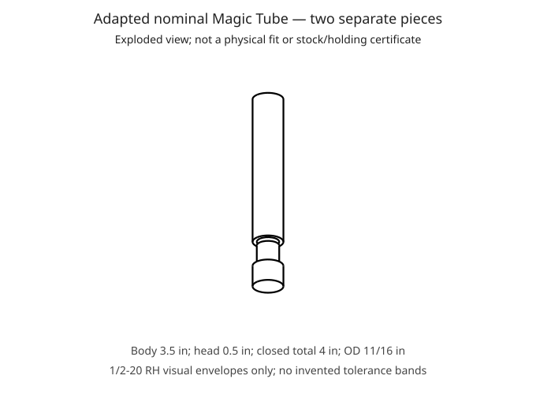

# Blondihacks Magic Tube — adapted source-size example

A complete **two-piece, removable screw-cap storage tube** route based on
Blondihacks' [*Metal Lathe Tutorial 18: Your Second Project!*](https://www.youtube.com/watch?v=-dyO4PEkEkc)
(2019-07-27). This is a **demonstration example, PLANNED/HOLD**, not a released
manufacturing drawing, an exact video replica, physical shop survey, safety
certificate or pressure/food-contact container design.

The video expressly allows different sizes and does not publish a complete
finished drawing. Its process and 1/2-20 right-hand thread are retained. Missing
size information is resolved through a plainly identified **adapted design**,
using real published source/catalog nominals—not dimensions claimed measured
from a video frame or invented tolerance bands. Source facts, adopted design
values and the author's reallocations are separated below.

## Design basis, without invented measurements

Inch conversions use exactly 25.4 mm/in. None of these nominal dimensions is
an acceptance band or physical measurement.

| Item | This adapted design | Actual basis and boundary |
| --- | --- | --- |
| Thread identity | 1/2-20 RH | Video 07:03–07:18; right hand explicit 10:28. Thread class/fit unknown. |
| Male stub length | 0.500 in / 12.7 mm | Video 05:28–05:45: counted indicator travel to the shoulder. Full usable thread length is not established. |
| Preliminary tube OD | 0.700 in / 17.78 mm | Video 03:00–03:36. This is **not** the finished joint-turned OD. |
| Finished body and cap OD | 11/16 in / 17.4625 mm | Deliberately selected catalog nominal [Continental Steel 12L14-6875](https://continentalsteel.com/item/steel-bars/cold-finished-round-bar-type-12l14/12l14-6875). The catalog sells **round bar**, not this finished tube. Adopting its nominal size as a finished OD is the author's design choice, not a claim of catalog tube geometry. |
| Drilling | 1/4-in pilot, then 15/32-in tap drill | Video 08:47–08:58. Actual diameters, drill points and usable reach remain unmeasured. |
| Blind cavity nominal depth | 3 in / 76.2 mm | Retained from the author's [older same-project article](https://blondihacks.com/lathe-magic-tube/), not a depth measured in the 2019 video. |
| Body length | 3.5 in / 88.9 mm | **AUTHOR'S CHOICE:** reallocate the older article's published **overall** 3.5-in size to this adapted **body**. The article does **not** specify a 3.5-in body. This deliberately leaves a nominal 0.5-in base under the selected 3-in cavity. |
| Cap **head** length | 0.500 in / 12.7 mm | Older article says to part 500 thou **behind the shoulder**. This is the head, not the entire cap. Adopted for this design; 2019 head length unknown. |
| Cap overall | 1 in / 25.4 mm | Derived from the separately sourced 0.500-in head plus 0.500-in male stub. |
| Closed assembly overall | 4 in / 101.6 mm | Derived from this adapted 3.5-in body plus the 0.500-in exposed head—not the older article's 3.5-in overall. |
| Material | 12L14 steel, adopted design | Older article identifies leaded 12L14; catalog supports its nominal size. The 2019 video calls its stock scrap and does **not** identify its alloy. Actual stock identity remains HOLD. |

The older article uses **0.500-in OD and 3/8-24 threading**, whereas the video
uses a 0.700-in preliminary OD and 1/2-20. Its dimensions and process are not
silently combined as if they were one exact drawing. The article's 3-in cavity
and 3.5-in overall/head discussion also does not establish a trustworthy blind
base boundary for the video. The explicit body-length reallocation above is
what makes this adaptation's closed base nonzero. It is an authored nominal
choice, not an assumed physical measurement.

No numerical dimensional tolerance, thread class, surface-finish limit,
chamfer size, edge-break band, torque or engagement acceptance is invented.
The source's suggested 80–100-thou wall is contextual process advice, not a
measured shop limit or automatic physics pass. The selected nominal wall below
the thread is 2.778125 mm, derived from OD and tap-drill nominal; the actual
thread-root wall, drilled hole and stock must still be established.

The approximately 0.805-in reading after the initial cleanup pass (video
02:37–03:01) is a process observation, not a raw-bar dimension or an acceptance
limit. The setup sheets give the operator actions directly; source chronology,
unused alternatives and older-article differences remain in this provenance
record rather than being repeated at each operation.

## Actual separate-piece model

`magic-tube.STEP` contains **two distinct solids** in the nominal closed
position: a blind-bored body and a shouldered cap. They are not fused, bonded,
or represented as a one-piece solid with a painted seam. The cap's major
cylinder lies in the body's major-envelope socket without positive-volume
interference; this is only a simplified visualization of threading.



The STEP does **not** model helical flanks, actual thread minor/blank diameter,
thread class, lead/runout, mating fit, root fillet, mouth chamfer, edge breaks,
temporary centre seat or drill-point cone. The cavity's flat schematic floor
is not a drill-tip prescription. The drawing and plan must resolve those
physical details before machining. A visually flush assembly cannot certify
the retention of a threaded cap under a facing or turning load.

Exact STEP bytes, face references, owner shells, geometric checks and generator
behavior are recorded in [geometry-provenance.md](geometry-provenance.md).

## Full chronological route

The plan has **nine setups**. It retains the source's one-bar split, remnant
cap, return to the original long tube blank, hand threading, cap facing while
screwed on, repeated joint OD passes and final part-off. It does not transplant
the older article's cap-first sequence, aluminum-can rechucking, final end
facing, cleaning chemistry or tail-centre-supported final turning.

| Setup | Complete work and repetition | Video source |
| --- | --- | --- |
| P1 | Face the irregular scrap end with a short rigid hold; preserve its mating edge; centre drill for later tail support. Start small drills between all three chuck jaws, not trapped between two. | 01:00–02:23 |
| P2 | Extend the bar with extra stock for later grip and part-off; apply the live centre; cleanup, measure and turn to **0.700-in preliminary OD**; make the separate finer-feed preliminary finishing pass. | 02:25–03:57 |
| P3 | Withdraw the live centre; begin parting the long tube blank, pause for accessible rear-edge deburring, then finish parting. Keep **both** the long exposed blank and the chuck-side remnant. | 04:02–04:31 |
| C1 | Use that remnant for the cap: face and clean the OD at least as large as the tube; set 0.500-in shoulder travel with the indicator; turn the male stub; finish the mating shoulder; chamfer; hand die-cut **1/2-20**; bevel again; part the cap with facing allowance. | 04:34–08:00 |
| T2 | Retrieve and rechuck the long tube blank, original faced/centred mouth out. Mark blind drilling depth; pilot 1/4 in, then 15/32 in; repeatedly peck/clear chips; hand tap deep enough for the cap; trial-fit; chamfer the **inside mouth** to clear the male root/remaining shoulder. | 08:08–10:23 |
| A1 | Screw on the actual cap to its shoulder, then face its outer head while body remains chucked. Remove the exposed outer edge burr, not the seam annuli. | 10:16–10:57 |
| A2 | Extend the complete assembly; indicate the base in the four-jaw; use the rolling bearing only to align the free end; **withdraw it**. Repeat very light full OD passes over body and cap until the seam disappears and the approved size is reached. Source explicitly says five or six **or more** passes may be needed. | 11:00–13:09 |
| A3 | Part the finished closed tube from the sound gripping tail, keeping the blind base intact. | 13:10–13:25 |
| F1 | Repeatedly open/close the cap and inspect the seam. The authored dimensional/fit recording procedures are additional release safeguards using only source-visible metrology, not claimed source measurements. | 12:50–13:09; 13:25–14:07 |

The source's one-bar sequence is preserved even though the parts are later
reoriented/rechucked into a closed assembly. It is not modeled as two unrelated
raw bars with fabricated origins. Stock dimensions, separation kerfs, initial
parting station, gripping tails and part-retention geometry are still unknown.

### Safety lessons, not required mistakes

- P3 uses an **editorial stopped-spindle deburring procedure**. The video shows
  a file on rotating stock near a partially parted piece; that unsafe action
  is not required or endorsed. Stop/isolate the machine and use a sound handled
  file before resuming the controlled parting operation.
- Select a safe drilling speed **before** engagement; the video's initial
  overly fast drilling and speed correction are not steps to reproduce.
- Hand threading uses an **unpowered spindle**. Stop before sliding the whole
  tailstock for chip clearance; lock it again before restarting drilling.
- The video accidentally unscrews the cap by facing across the centre. That is
  a warning, **not a mandatory failure-and-recovery operation**. Confirm secure
  thread engagement/shoulder seating and the tightening cut direction; never
  feed across the spindle axis. If the cap moves, stop. No extra invisible
  antirotation fixture or certified thread retention is invented.
- The rolling bearing is an **alignment tool**, not a follow rest. It is
  withdrawn before the final unsupported turning. Source 0.002–0.003-in light
  passes and approximately 0.005-in alignment TIR are observations/advice, not
  automatically safe recipient settings or acceptance limits.
- No gloves, reaching for cutoffs, or hands near powered rotating work.
  Source glove appearances do not establish safe lathe practice.

These safeguards do not close the unmeasured holding, deflection, tooling,
thread retention or physical first-article acceptance debt.

## Video-only independent shop

`inventory.toml` is local to this bundle. It contains only genuinely used source
objects: manual lathe; independent four-jaw chuck; live centre for initial
turning; jaw protection strips; turning/facing, chamfering and parting tools;
centre drill, 1/4-in pilot and 15/32-in drill; 1/2-20 die and tap; tailstock drill
chuck, die holder, tap wrench/follower; hand file; depth marker; dial caliper;
dial indicator; rolling-bearing alignment tool; and visibly applied cutting oil.

The dial caliper is visibly **Lyman at 03:04**, not the generic Mitutoyo item
in the video description's affiliate list. The jaw strips are copper-coloured,
but colour is not asserted as material identification. The red 3D-printed
indicator support is visible at 11:12 and described by the source; its file is
linked in metadata, but no fabrication dimensions are invented.

The affiliate list is **not** treated as an installed inventory. No borrowed
Pedro-shop data, micrometer, thread gauge, reamer, saw, grinder, tail centre for
final finishing, coating or cleaning chemical is added to make rules pass.
Source visibility (`present=true`) is not proof those items exist in a user's
shop. Dimensions, tool material, exact machine model/capabilities, gauge
calibration and installed tool stacks remain literal `"unknown"` where not
established. No measurement records are fabricated.

`shop-policy.toml` and `cutting-data.toml` are likewise independent. Complete
safe RPM/feed/depth selections and numeric shop limits are unavailable; the
plan retains that debt instead of importing unrelated cutting tables.

## Reproduction and source cache

The actual full MP4, both YouTube English automatic-caption variants and info
JSON were downloaded into the external cache
`C:/Users/pedro/.cache/prechips/video--dyO4PEkEkc/`, not this repository. The local
MP4 has H.264 video plus AAC audio, 1920 × 1080, 29.97 fps, **862.6 s** (14:22.6),
about 319.7 MiB. Metadata rounds duration to 863 s. The requested formats were
**137+140** and the download/merge completed with exit 0. Captions are source
YouTube automatic captions, not a new Whisper transcription; critical tool
classes, holding and orientation were checked against actual video frames.

A fresh acquisition can use `yt-dlp` with suitable lawful access:

```sh
uv tool run yt-dlp --no-playlist -f "137+140" --merge-output-format mp4 --write-auto-subs --sub-langs en-orig,en --write-info-json -o "-dyO4PEkEkc.%(ext)s" "https://www.youtube.com/watch?v=-dyO4PEkEkc"
```

Authentication/cookies and signed download URLs are not published. Reproduction
is an instruction, not a promise that anonymous downloads work in every
network/environment. Full source media, captions, the older article sketch,
probe scripts and raw research remain outside git. Only short source ledger,
provenance and authored example files are included here.

With native FreeCAD available:

```sh
freecadcmd.exe examples/blondihacks-magic-tube/build_part.py
uv run prechips traveler examples/blondihacks-magic-tube/plan.toml --out out/blondihacks-magic-tube
```

The HTML is printable setup sheets; the adjacent JSON retains rule details and
uncertainty. Generation is offline and never fetches the video or catalog.
Schema/native/export success is not physical machining acceptance.
