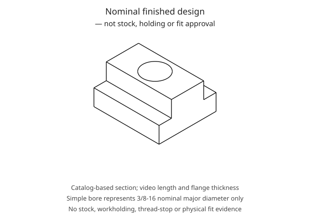

# Blondihacks T-nuts — catalog-based example design

A standalone, **four-piece 1018-steel T-nut job** using the process demonstrated in
Blondihacks' [*Let's Make T-Nuts! Your first milling project*](https://www.youtube.com/watch?v=TL0OsfFkBL8)
(2020-05-02). It has a complete route and a one-nut STEP, not four modeled nuts.
The section uses selected [Carr Lane CL-0-TN catalog dimensions](https://www.carrlane.com/product/clamping-hardware/studs-bolts-t-nuts/t-nuts)
where the video does not publish dimensions. This is an **adapted example design**,
not an exact video reconstruction, a commercial-part replica, or a released
manufacturing drawing.

The setup sheets remain **PLANNED/HOLD**. Known catalog design nominals are not
physical shop measurements. No invented measurement records, tool sizes,
cutting recommendations, machine capabilities or tolerance bands clear the
remaining debt. The inventory, policy and cutting data are local: nothing is
inherited from Pedro's shop or the video's generic affiliate shopping list.

## Selected design, dimension by dimension

All dimensions below are **nominal design values**, not acceptance limits.
Inch-to-mm conversions use exactly 25.4 mm/in.

| Item | Selected nominal | Basis |
| --- | --- | --- |
| Quantity | 4 | Video 02:42–02:50; confirmed 06:43 and the later batch operations. |
| Material | 1018 steel | Video stock marking and narration 03:59. No material condition/certificate established. |
| Finished length, X | 1 in / 25.4 mm | Video 02:42–02:50; repeatable end facing 12:17–12:52. |
| Base width, Y | 7/8 in / 22.225 mm | Selected Carr Lane CL-0-TN dimension **C**. |
| Overall height, Z | 1/2 in / 12.7 mm | Selected Carr Lane CL-0-TN dimension **E**. |
| Stem width, Y | 0.495 in / 12.573 mm | Selected Carr Lane CL-0-TN actual nominal dimension **B** for a nominal 1/2-in slot; not a 0.500-in stem. |
| Flange thickness | 0.250 in / 6.35 mm | Video narration 06:47 and visible `250 thou = 6.35mm` overlay at 06:50. |
| Hole location | Centered in X and Y | Video midpoint/half-function method 07:17–07:33 and hole pickup 12:52–13:08; no positional tolerance. |
| Through thread | 3/8-16 | Video hardware comparison 02:23–02:39, drill/tap 13:11–13:32. Thread class unspecified. |

The actual Carr Lane CL-0-TN has **7/8-in length D and 9/32-in flange F**;
those two values are **not** used here. The selected length and flange instead
follow the video. The manufacturer drawing publishes B/C tolerance information,
but those bands are **not adopted** as an acceptance specification for this
combined design. Local design **BH-TN-EXAMPLE / catalog-design-1** identifies
this authored example, not an original video drawing or release approval.
Numerical tolerance bands, thread class, edge-break size and roughness limits
remain unknown.

The video asks the viewer to measure the recipient table's slot rather than
giving a universal drawing. A catalog's nominal 1/2-in slot designation does
not prove that this nut will fit another mill. Measure the actual throat,
undercut and depth, establish suitable fit limits, and perform the final
functional checks before using the nuts.

### Model and tool-coordinate boundary

The STEP uses X along the one-inch length, Y across the symmetric section,
and Z upward from the bottom. See [geometry-provenance.md](geometry-provenance.md)
for the generator, exact face identities, source/design distinctions and digest.
The bore is a **9.525-mm nominal-major visual envelope**, not a tapping-drill
size, finished minor diameter or modeled helical thread. Edge breaks, cold-blue
effects and the bottom-thread staking deformation are not represented. The
STEP does not stop a stud from passing through; the physical retention check does.



The source's nominal **±0.477-in cutter-center coordinates** and **0.010-in
finish allowance** are machining demonstrations, not a stem-width drawing.
Do not transfer the ±0.477-in coordinate to this selected 0.495-in stem.
For a measured finishing-cutter diameter `D`, the nominal shoulder-wall
cutter centers are `Y = ±(12.573/2 + D/2)` mm. Tool diameter, reach, physical
zero and clearance must be established before any move. The example does not
supply a numeric substitute for missing `D`.

## Complete route and source ledger

The plan contains **13 setups**. B0 through C2 describe processing **one batch
bar once**; E1 onward repeat the relevant operation on **each of the four
separated nuts**. The one-part STEP neither supplies raw-bar length nor
simulates changing batch/offcut retention.

| Setup | Planned work | Source video |
| --- | --- | --- |
| B0 | Measure the actual T-slot; distinguish 3/8-16 hardware from misleading M10 × 1.5 near-fit; use the portable powered band saw to cut stock held in the bench vise. | 01:30–02:52; band wheels/blade visible at 02:45. |
| Q1 | Face the first long reference surface; remove seating burrs. | 03:03–04:03. |
| Q2 | Seat that face against the fixed jaw, use round bar at the moving jaw, and face the adjacent long surface. | 04:06–04:28. |
| Q3 | Use the squared corner as a reference and face the opposite long side; measure the width. | 04:30–05:36. |
| Q4 | Support on parallels and face the fourth long surface to overall height; keep head/quill/table rigid. | 05:47–06:34. |
| S1 | Choose grip/parallel height for shoulder clearance; edge-find both sides, use the DRO half function, rough both shoulders with cutting fluid, then finish conventionally. | 06:43–10:25. |
| C1 | Mark the lengths, stand the bar UPRIGHT and saw pieces from its top with the horizontal mill-mounted slitting disk; cut-plane normal is machine Z. | 10:25–11:30; upright cut visible 11:05. |
| C2 | Clamp the short UPRIGHT remainder at the vise end; balance the opposite jaw end with a separated nut. Paper goes with the cutting workpiece so it grips more tightly. | 11:31–11:50. |
| E1 | Put each nut at the left vise end with the cutting end overhanging both jaws/supports; the opposite end locates against the rod stop from the right. | 12:17–12:52. |
| D1 | Pick up the accessible finished end, locate the midpoint, centre drill, drill through, and hand tap 3/8-16 with cutting fluid and spring follower. | 12:52–13:40. |
| B1 | Noga-deburr both hole mouths, needle-file small edges, then punch/stake the bottom thread and check stud retention. | 13:40–15:06. |
| B2 | Acetone-clean; JAX immersion, rinse, dry, buff; optional scuff/repeat; apply oil and wipe. | 15:08–16:45. |
| F1 | Prove sliding fit, below-table top, shoulder bearing and prevention of stud pass-through in the actual table. | 17:00–17:33. |

Squaring and appearance finishing are described as optional in the video, but
are retained here rather than silently dropping demonstrated phases. Four
long-face preparation setups precede the shoulder cuts; end finishing follows
separation. The black Niagara HSS TiCN squaring cutter is distinct from the
gold-coloured shoulder rougher shown beside the finisher at 07:44. The source
leaves 0.010 inch on the shoulder walls only, with the rough-cut floors already
at flange height; it touches the finisher on that floor at 09:35–09:40.
The two-tool shoulder route is retained, although the video mentions a suitable
finishing cutter alone as an alternative. No coating/material is inferred from
the gold colour.
Between early setups, the plan explicitly selects the video's later hand files
for seating-burr removal; the exact early deburring tool is not established.

### Editorial safeguards, not claimed video equipment

- **No gloves near the rotating spindle.** The source's one-glove anecdote at
  12:03–12:17 is not adopted as machining practice. Chemical-compatible gloves
  belong only in the separate stopped-machine chemical task.
- **Do not catch or retrieve loose cut-offs near a running saw.** C1/C2 remain
  HOLD until work/offcut retention and full blade/arbor/jaw/support clearance
  are established. No extra retention guard or engineered fixture is claimed
  visible in the source; the balancing-piece arrangement alone is not a proof.
- The source emphasizes conventional milling, sufficient jaw grip, cutter
  clearance, quill/head rigidity and unused-axis locking. Actual dimensions
  and settings still need to be measured rather than read off a rendered image.
- Hand tapping is with the **spindle stopped**. Through-drill point clearance,
  parallel/vise avoidance, tap lead breakthrough and follower travel remain
  prerequisites, not inferred from the simple bore.
- The chemical sequence is a record of the demonstration, **not a complete
  chemical-safety instruction**. Confirm the actual JAX formulation/label/SDS,
  compatible container, ventilation, splash protection, solvent/fire controls
  and disposal before starting. The source's approximately 30-second immersion
  does not override the actual product instructions.

## Remaining unknowns and release debt

These are intentional missing facts, not an incomplete route:

1. **Recipient slot and acceptance:** actual throat/undercut/depth readings,
   fit-clearance limits, below-table clearance, approved dimensional bands,
   thread class/engagement limits, flatness/squareness/roughness and edge breaks.
   Known catalog/video nominals are retained separately from these unknowns.
2. **Stock:** on-hand status, raw section and batch length, incoming position,
   saw kerf, separation cut-line pitch, end cleanup and actual squared readings.
   The spoken 0.100-in allowance is not certified blade kerf or adopted stock pitch.
3. **Source mill:** exact model, travel/envelope, spindle limits/power, rotation,
   controller manual, DRO direction and measured least-readable increments.
   The PM logo/Precision Matthews DRO does not identify a PM-30MV.
4. **Tooling:** rougher/finisher and finder diameters, flutes/reach, holder
   identities and projections, slitting blade/arbor dimensions and teeth,
   centre-drill size/pilot, tap-drill diameter/point, tap geometry/lead and
   follower travel. No generic affiliate-list tools are substituted.
5. **Holding and zeros:** measured vise/jaw/parallel/round-bar/stop dimensions,
   alignment, jaw engagement, cutter/jaw/support clearance, actual stock-state
   heights, pickup compensation, Z-touch method and reversal-check distances.
   Nominal CAD frames are not physical pickup records.
6. **Cutting data:** safe RPM, feeds, pass depths, coolant product, approach and
   breakthrough values. Demonstrated 0.070-in cuts and source tool-center
   coordinates are not a cutting-data table for another setup.
7. **Metrology and finish:** caliper range/resolution/calibration and actual
   readings; exact chemical formulation/handling; coating thickness; bottom
   thread deformation and useful engagement. Functional fit does not certify
   a clamping load rating or physical first article.

`"unknown"` is the strict schema's debt value. No shop measurement metadata is
fabricated, and no source nominal is relabeled as an assumption or a physical
measurement. Obtaining approval/measurements must precede released machining;
a successful schema parse, report or render is not that approval.

## Files and reproduction

| File | Purpose |
| --- | --- |
| `plan.toml` | All 13 setups, batch/repetition instructions, physical-zero debt, tools, inspections and editorial safeguards. |
| `features.toml` | Selected nominal design, unknown acceptance bands, exact STEP digest/face references and source provenance. |
| `inventory.toml` | Only the video's shown/used equipment and consumables, with unknown physical dimensions. |
| `shop-policy.toml` | Local required baseline checks and explicitly unknown numeric shop thresholds. |
| `cutting-data.toml` | Explicitly unknown recommendations; no copied shop/handbook values. |
| `build_part.py`, `t-nut.STEP`, `geometry-provenance.md` | Reproducible one-part design and geometry/face provenance. |

From the repository root, generate the report and printable setup sheets with:

```sh
uv run prechips traveler examples/blondihacks-t-nuts/plan.toml --out out/blondihacks-t-nuts
```

The intended operator-facing output is `out/blondihacks-t-nuts/traveler.html`;
findings remain in the adjacent `report.json`. Generation requires no live
video/catalog fetch. The source MP4, captions and metadata were acquired into
an **external local cache**, not this repository. To acquire a fresh local
research copy, an example command is:

```sh
uv tool run yt-dlp --format "bv*[height<=1080]+ba/b[height<=1080]" --merge-output-format mp4 --write-auto-subs --sub-langs en-orig --write-info-json --output "TL0OsfFkBL8.%(ext)s" "https://www.youtube.com/watch?v=TL0OsfFkBL8"
```

That is a reproduction instruction, not a claim that this exact command was
used in every environment. Authentication/cookie details are intentionally
not copied. Do not commit the full video or captions. The inspected local
video is 1920 × 1080, about 18:05, with matching English automatic captions.
The caption extraction is summarized above rather than reproduced wholesale.

Important ASR corrections: **four**, not “forty”; **3/8-16**, not “3/16”;
T-nut/T-slot, not “tea nut/tea slot.” The oil's product/type is not established;
the source says any oil will work, so the plan does not assert way oil.
The garbled “soccer” phrase near 02:42–02:52 is interpreted cautiously as
separation/saw allowance, not a dimensioned manufacturing instruction.

